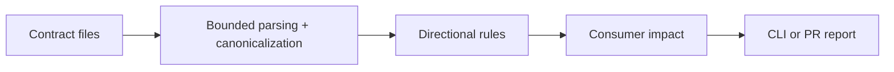

# ContractPulse

**API and event schema compatibility checks.** ContractPulse compares versions of an API or event contract, finds which registered consumers could break, and produces a CI report showing the exact rule behind each finding.

> **Status:** early development, following a 6-week roadmap (see below). It works on local contract files and synthetic consumers.

## The problem

A producer's tests can pass while an API or event change breaks downstream clients. Before merging a contract change, teams need to know:

- is this change safe, breaking, or impossible to judge from the schema alone?
- does it break requests, responses, or both?
- which known consumers depend on the affected fields?

ContractPulse answers these in the terminal and in pull request checks.

## Demo workflow

1. In a fictional `orders.created` event, change `orderId` from string to number
2. Remove a field that consumers expect
3. See the rule findings for each change
4. See the two registered consumers the change affects
5. Read the generated pull request report

## Planned features

- Import of local OpenAPI and JSON Schema files, with stable hashes and bounded reference resolution
- CLI that classifies supported changes as SAFE, BREAKING or UNKNOWN
- Separate compatibility checks for requests and responses
- Registry of consumers mapped to contract versions, with impact reports
- JSON and Markdown report exports
- Pull request checks in an authorized test repository
- Time-limited waivers with audit history

## Tech stack

| Layer | Technology |
|---|---|
| CLI and compatibility engine | TypeScript |
| Frontend | Next.js |
| API | Fastify |
| Database | PostgreSQL, Prisma |
| Testing | Vitest, Playwright |
| Packaging | Docker |

## Architecture



**Core entities:** Service, Contract, ContractVersion, Consumer, Dependency, CompatibilityRule, Difference, AnalysisRun, Waiver, PullRequestCheck.

## Design rules

- Unsupported schema constructs are reported as UNKNOWN, never guessed.
- Remote references are never fetched, and input size and depth are limited.
- Reports only claim impact on registered consumers.
- Expired waivers stop bypassing the policy automatically.
- The core engine runs locally without a database.

## Roadmap

| Week | Focus | Status |
|---|---|---|
| Week 1 | **W01-01 + CI** — Scaffold TypeScript workspace with CLI package, read contract files and reject malformed input | ✅ Done |
| Week 2 | **Engine** — Add bounded parsing, canonicalize and hash contracts, detect type changes, detect field removals, detect requiredness changes | ✅ Done |
| Week 3 | **Diffs & registry** — Print readable directional diffs, add JSON output and exit codes, add workspace registry for services and versions | ✅ Done |
| Week 4 | **Impact** — Track consumer dependencies, compute change impact, add version and impact views, export review reports | Planned |
| Week 5 | **Waivers & PR checks** — Add auditable waivers with expiration, add pull request check | Planned |
| Week 6 | **Release** — Enforce size and depth limits and benchmark parsing, package with Docker, add end-to-end tests and architecture docs | Planned |

## Documentation

- [Initial rule scope](docs/rule-scope.md) — supported inputs, verdicts, direction and the first compatibility rules
- [Registry API](packages/api/README.md) — workspaces, services and contract version history

## Getting started

Requires Node.js 20+ and pnpm 9.

```sh
pnpm install
pnpm build

# Check that files are supported contracts
node packages/cli/dist/index.js validate fixtures/contracts/*.json

# Compare two versions of the demo event
node packages/cli/dist/index.js diff \
  fixtures/contracts/orders.created.v1.schema.json \
  fixtures/changes/orders.created.v2.schema.json
```

`diff` prints one block per finding, BREAKING first: the rule, why it matters, the direction (who reads the data), the JSON Pointer and the old (`-`) and new (`+`) value, then the overall verdict.

For CI jobs and scripts, `--format json` prints the same findings as a versioned JSON report (`schemaVersion`, `verdict`, `summary`, both contracts' hashes, and each finding's rule, direction, OpenAPI location, pointers and values). `--fail-on` sets which verdict fails the run:

```sh
node packages/cli/dist/index.js diff --format json --fail-on unknown old.json new.json
```

| Exit code | `diff` | `validate` |
| --- | --- | --- |
| 0 | No finding at or above `--fail-on` (default `breaking`; `never` always passes) | Every file is valid |
| 1 | A finding at or above `--fail-on` | A file is invalid |
| 2 | Usage error | Usage error |
| 3 | A file is not a valid contract, or the two are of different kinds (with `--format json`, an error report is printed) | — |

### Registry

The registry API (`packages/api`) stores contract versions per workspace and service, with source metadata. It needs PostgreSQL; `compose.yaml` starts one. See [packages/api/README.md](packages/api/README.md) for setup and endpoints.

### Web UI

`packages/web` is a Next.js app over the registry: services, each contract's version history and registered consumers, and for any version the impact on every consumer — status, the version it is pinned to, the fields it uses, and each finding's field, rule, direction and before/after values. It reads the API on the server with a workspace token, so the token never reaches the browser.

```sh
# with the registry running on :3001 and the demo workspace seeded
cp packages/web/.env.example packages/web/.env.local
pnpm --filter @contractpulse/web dev    # http://localhost:3000
```

| Variable | Default | |
| --- | --- | --- |
| `CONTRACTPULSE_API_URL` | `http://127.0.0.1:3001` | Registry API |
| `CONTRACTPULSE_WORKSPACE` | `demo` | Workspace slug to show |
| `CONTRACTPULSE_API_TOKEN` | — | Bearer token for that workspace (required) |
