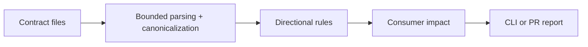

# ContractPulse

**API and event schema compatibility checks.** ContractPulse compares versions of an API or event contract, finds which registered consumers could break, and produces a CI report showing the exact rule behind each finding.

> **Status:** early development, following a 6-week roadmap (see below). It works on local contract files and synthetic consumers.

## The problem

A producer's tests can pass while an API or event change breaks downstream clients. Before merging a contract change, teams need to know:

- is this change safe, breaking, or impossible to judge from the schema alone?
- does it break requests, responses, or both?
- which known consumers depend on the affected fields?

ContractPulse answers these in the terminal and in pull request checks.

## Demo workflow

1. In a fictional `orders.created` event, change `orderId` from string to number
2. Remove a field that consumers expect
3. See the rule findings for each change
4. See the two registered consumers the change affects
5. Read the generated pull request report

## Planned features

- Import of local OpenAPI and JSON Schema files, with stable hashes and bounded reference resolution
- CLI that classifies supported changes as SAFE, BREAKING or UNKNOWN
- Separate compatibility checks for requests and responses
- Registry of consumers mapped to contract versions, with impact reports
- JSON and Markdown report exports
- Pull request checks in an authorized test repository
- Time-limited waivers with audit history

## Tech stack

| Layer | Technology |
|---|---|
| CLI and compatibility engine | TypeScript |
| Frontend | Next.js |
| API | Fastify |
| Database | PostgreSQL, Prisma |
| Testing | Vitest, Playwright |
| Packaging | Docker |

## Architecture

**Core entities:** Service, Contract, ContractVersion, Consumer, Dependency, CompatibilityRule, Difference, AnalysisRun, Waiver, PullRequestCheck.

## Design rules

- Unsupported schema constructs are reported as UNKNOWN, never guessed.
- Remote references are never fetched, and input size and depth are limited.
- Reports only claim impact on registered consumers.
- Expired waivers stop bypassing the policy automatically.
- The core engine runs locally without a database.

## Roadmap

| Week | Focus | Status |
|---|---|---|
| Week 1 | **W01-01 + CI** — Scaffold TypeScript workspace with CLI package, read contract files and reject malformed input | Planned |
| Week 2 | **Engine** — Add bounded parsing, canonicalize and hash contracts, detect type changes, detect field removals, detect requiredness changes | Planned |
| Week 3 | **Diffs & registry** — Print readable directional diffs, add JSON output and exit codes, add workspace registry for services and versions | Planned |
| Week 4 | **Impact** — Track consumer dependencies, compute change impact, add version and impact views, export review reports | Planned |
| Week 5 | **Waivers & PR checks** — Add auditable waivers with expiration, add pull request check | Planned |
| Week 6 | **Release** — Enforce size and depth limits and benchmark parsing, package with Docker, add end-to-end tests and architecture docs | Planned |

## Documentation

- [Initial rule scope](docs/rule-scope.md) — supported inputs, verdicts, direction and the first compatibility rules

## Getting started

Setup instructions will be added once the CLI is in place.
